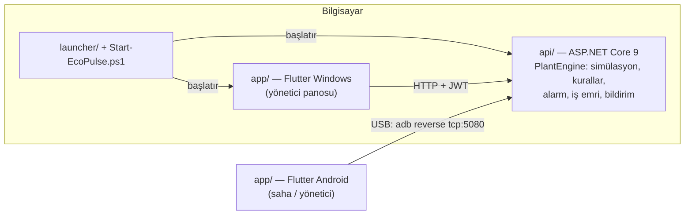

# EcoPulse OSB

**Organize sanayi tesisleri için enerji kaybı ve ısı kaybı erken uyarı platformu.**

Makinelerin voltaj, akım ve sıcaklık telemetrisini izler; aşırı akım, atık ısı ve boşta çalışma durumlarını yakalar; kaybı **TL/saat** ve **kg CO₂/saat** olarak gösterir; doğru teknisyene yönlendirir ve bakım sonrası düzelmeyi **ardışık 3 normal ölçümle doğrular**.

> Prototip: telemetri simülasyonla üretilir. Gerçek sensör, sayaç veya bulut servisi yoktur. Ayrıntılar: [Teknik rapor](EcoPulse-Proje-Teknik-Raporu.pdf)

## Ne yapar?

| Adım | Ne olur |
|---|---|
| İzle | 5 makine, 2 saniyede bir voltaj / akım / sıcaklık / güç |
| Yakala | Eşik 3 ardışık ölçüm (≈6 sn) aşılınca alarm: aşırı akım, atık ısı, boşta çalışma |
| Fiyatla | Kayıp gücü → TL/saat ve kg CO₂/saat; yıllık karşılığı |
| Su | Makine bazında canlı soğutma suyu debisi (m³/h) ve tesis toplam debi trendi; arızaya fiziksel tepki; önlenen (dolaylı) su |
| Yönlendir | Alarm makinenin sorumlu teknisyenini gösterir; yönetici telefonuna bildirim düşer |
| Doğrula | Bakım bildirimi sonrası 3 normal ölçüm gelirse iş emri "Doğrulandı" olur ve kesilen kayıp özete eklenir |

## Mimari



- **Tek motor, tek kod tabanı:** Tüm iş kuralları API'de; Windows, Android ve web aynı Flutter kodundan çıkar.
- **Rol tabanlı erişim:** `operator` (saha) ve `manager` (yönetici) rolleri JWT claim'iyle sunucuda denetlenir.
- **Cihaz bazlı bildirim:** Yönetici masaüstünde ve telefonda aynı anda açıkken her cihaz bildirimi ayrı alır.

## Çalıştırma

Gereksinimler: Windows, .NET 9 SDK, Flutter (stable). Telefon için Android SDK platform-tools (`C:\Android\platform-tools\adb.exe`).

1. `Start-EcoPulse.ps1` dosyasını bir kez çalıştırın (sağ tık → PowerShell ile çalıştır). Masaüstüne **EcoPulse** kısayolu kurulur.
2. Sonraki her açılışta kısayola çift tıklayın. Betik:
   - kaynak değiştiyse API, launcher ve Flutter uygulamasını derler (açık kalan eski süreçleri önce kapatır),
   - API'yi arka planda açar ve hazır olmasını bekler,
   - USB ile bağlı Android telefon varsa uygulamayı yükler, API tünelini kurar ve açar,
   - masaüstü penceresini açar.

Hata günlüğü (derleme çıktısı dahil): `%LOCALAPPDATA%\EcoPulse\start-log.txt`

### Telefonu bağlama

1. Android'de **Geliştirici seçenekleri → USB hata ayıklama**'yı açın (görünmüyorsa **Telefon hakkında → Yazılım bilgileri → Yapım numarası**'na 7 kez dokunun).
2. Telefonu veri kablosuyla bağlayın ve bilgisayara izin verin.
3. Kısayola çift tıklayın. Aynı Wi-Fi gerekmez; kablo takılı kalmalıdır.

### Demo hesapları

| Kullanıcı | Parola | Rol |
|---|---|---|
| `operator` | `operator` | Saha teknisyeni |
| `manager` | `manager` | Tesis yöneticisi |

## 3 dakikalık demo akışı

1. **Yönetici** masaüstünde, **saha** telefonda (veya tersi) giriş yapar. Özet: toplam güç, aktif alarm 0.
2. Saha: *Fırın Konveyörü* → **Arıza**. ≈6 sn sonra yöneticinin telefonuna bildirim: *"Atık ısı · … TL/saat · Sorumlu: Selin Arslan"*.
3. Yönetici panosunda alarm kırmızı, aktif kayıp TL/saat olarak görünür; sıcaklık grafiği eşiği aşarken soğutma suyu debisi yarıya düşer ve pompa hattı çubuğu kırmızıya döner.
4. Saha veya yönetici: **Bakım Bildir**. Alarm "Doğrulanıyor 1/3 → 3/3" ilerler ve **Doğrulandı** olur.
5. Özet: **Kesilen kayıp** (TL/saat), **CO₂** ve **yıllık karşılığı** güncellenir.
6. Yönetici **Personel** ekranından makineyi başka teknisyene atar; uzmanlık uyuşmazlığı uyarısı gösterilir.

Demoyu sıfırlamak için Görev Yöneticisi'nden **EcoPulse.Api** sürecini kapatıp kısayolu yeniden açın (durum bellektedir; açık uygulamalar oturumu kaybetmeden yeniden bağlanır).

## Hesaplama özeti

| Kural | Tetikleme | Kayıp gücü |
|---|---|---|
| Aşırı akım | I − I<sub>nom</sub> > %20 I<sub>nom</sub> | √3 · V · ΔI · 0,85 / 1000 |
| Boşta çalışma | 0,10 ≤ I / I<sub>nom</sub> < 0,35 | √3 · V · I · 0,25 / 1000 |
| Atık ısı | T > T<sub>max</sub> | h · A · (T − 25 °C) / 1000, h = 10 W/m²·°C |

TL/saat = kW × 4,092 TL/kWh (demo birim fiyatı; sahada tesisin faturasındaki değer) · CO₂ = kW × 0,474 kg/kWh · Yıllık = TL/saat × 8760 (7/24 sürdüğü varsayımıyla; tek vardiyada ÷ 3).

CO₂ faktörü: T.C. Enerji ve Tabii Kaynaklar Bakanlığı, [2022 elektrik tüketim noktası emisyon faktörü](https://enerji.gov.tr/Media/Dizin/EVCED/tr/%C3%87evreVe%C4%B0klim/%C4%B0klimDe%C4%9Fi%C5%9Fikli%C4%9Fi/EmisyonFaktorleri/2022_Uretim_Tuketim_EF.pdf), dağıtım şebekesine bağlı tüketici: 0,474 tCO₂/MWh.

### Su debisi ve önlenen su

- **Canlı debi (simülasyon):** `Q = Qnom × [1 + 0,07·sin(2πt/T + φ) + 0,025·sin(2πt/9 + 2φ)] × arıza tepkisi × (1 + ε)`. Atık ısı arızasında soğutma debisi %45–58'e düşer, aşırı akımda %12–22 artar, boşta çalışmada makine üretmese de su akmaya devam eder. Panoda her pompa hattı nominale göre renklenir (<%75 kırmızı, >%110 amber).
- **Önlenen su (dolaylı):** `doğrulanan tasarruf (kWh/yıl) × 0,693 m³/MWh ÷ 1000`. Fabrikada tasarruf edilen elektriğin santral soğutmasında önlediği sudur.
- **Katsayı kaynağı:** Türkiye 2016 ulusal ortalaması, 693 m³/GWh (188 milyon m³ soğutma suyu / toplam üretim). El-Khozondar, B. (2017), Hacettepe Üniversitesi yüksek lisans tezi; El-Khozondar & Aydınalp Köksal, *E3S Web of Conferences* 22, 00039 (2017), [doi:10.1051/e3sconf/20172200039](https://doi.org/10.1051/e3sconf/20172200039). Değer `api/appsettings.json` → `Water` bölümündedir.

## API uç noktaları

| Yöntem | Yol | Rol |
|---|---|---|
| POST | `/auth/login` | herkes |
| GET | `/auth/me` | giriş yapmış |
| GET | `/machines`, `/alarms` | giriş yapmış |
| POST | `/machines/{id}/fault`, `/machines/{id}/normal` | operator, manager |
| POST | `/alarms/{id}/maintenance` | operator, manager |
| GET | `/dashboard`, `/personnel` | manager |
| POST | `/personnel/{pid}/assign/{mid}`, `/machines/{id}/unassign` | manager |
| GET / POST | `/notifications?device=…`, `/notifications/{id}/ack?device=…` | manager |
| POST / DELETE | `/devices`, `/devices/{token}` | giriş yapmış |
| GET | `/health` | herkes |

## Proje düzeni

```
api/                ASP.NET Core 9 Web API ve simülasyon motoru (PlantEngine.cs)
app/                Flutter istemci (lib/, test/, android/, windows/, web/)
launcher/           API + masaüstü uygulamasını açan Windows başlatıcısı
Start-EcoPulse.ps1  Tek tık derleme + başlatma + telefon eşleme
.github/workflows/  CI: .NET derlemesi, flutter analyze ve flutter test
```

## Sınırlar ve yol haritası

- Telemetri simülasyondur; sıradaki adım Modbus/MQTT ile gerçek enerji analizörü ve sıcaklık sensörü bağlamaktır.
- Durum bellekte tutulur; kalıcı veritabanı (PostgreSQL/TimescaleDB) planlanmıştır.
- Su debisi simülasyondur; sıradaki adım elektromanyetik / ultrasonik debimetrenin Modbus veya M-Bus ile bağlanmasıdır.
- Demo kullanıcıları ve JWT anahtarı yerel geliştirme içindir; üretimde kimlik sağlayıcı ve gizli anahtar yönetimi gerekir.
- Bildirim yerel sorgulama ile çalışır; uzaktan kullanım için FCM planlanmıştır.
- Tarife ve emisyon katsayıları sabittir; yapılandırılabilir hâle getirilmelidir.
